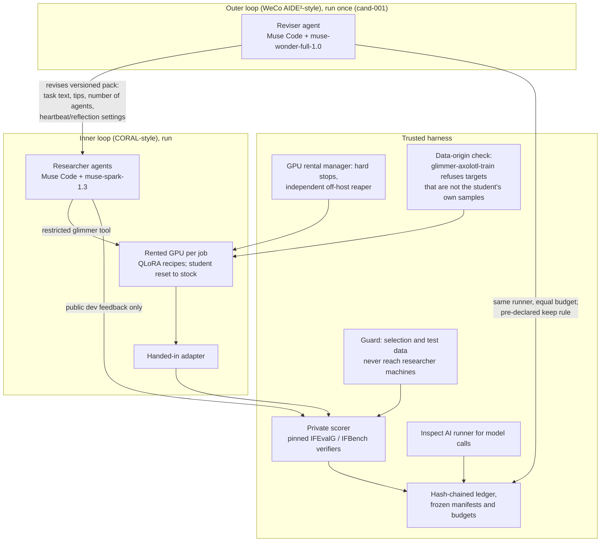

# Glimmer Lab: hackathon submission pack

Status of this pack: authored (text exists; it is not a result). Headline: both loops ran for real; on this small evidence the Nightshift-revised researchers made SFT more reliable but not better; the held-out comparison did not produce a valid pair. Exploratory; no improvement claim. Facts verified as of 2026-11-03 21:00 ET, updated 2026-11-03 21:30 ET and 2026-11-04 07:35 ET, and superseded where contradicted by the final results update of 2026-11-04 13:48 ET and the updated full run record of 2026-11-04. Final E1 scores are quoted exactly in `REPORT.md` section 12.1; private per-item results stay out.

## Purpose

Glimmer Lab (Python package `nightshift`, inside the repository `meta-hackathon`) is a two-loop post-training system for Muse Glimmer (Meta's 30B open-weight reasoning model, checkpoint `meta-models/Muse-Glimmer-30B` revision `a4e59da52a7bc87ae7251dd5545c0dd437c44b68`). In the inner loop, a small team of AI researcher agents writes and runs QLoRA post-training recipes on a rented GPU through a restricted tool and hands in an adapter, with the student reset to the stock checkpoint for every trial. In the outer loop, a stronger agent revises the researchers' versioned "pack" and the same runner evaluates the revision at an equal budget, under a keep rule fixed before candidate results. A trusted harness (private scorer, hash-chained ledger, frozen manifests and budgets, and a guard that keeps selection and test data away from researchers) is meant to make the comparison auditable. That harness also enforces a data-origin rule: the training command `glimmer-axolotl-train` refuses any data in which an assistant target is not an unmodified, verifier-passing, non-truncated sample of the local Glimmer model (`muse-glimmer`) recorded for an approved public training prompt, and writes a hash record for the training inputs. Code authorship and training targets are different things: no answers from Claude, Muse Spark, Muse Wonder or other agents may be training targets. Both loops ran for real (Spark researchers in CORAL through the `glimmer` tool on rented A100s; one Wonder Full revision, `cand-001`, generation time box 2700 s -> 720 s, evaluated with the same runner and the same 72-GPU-minute trial budget). Owner scope: original SFT vs Nightshift-improved SFT from the same checkpoint; stock Glimmer is context only, not SFT and not a success gate. On the frozen private E1 selection split (300 prompts), original SFT (fresh `lab2p t-0006`) scored 55.0% pass-all / 76.4% mean constraint fraction; Nightshift-improved SFT scored 52.0% / 75.4% (screening `t-0003`, the trial that selected the candidate) and 47.0% / 70.1% (fresh `t-0004`); stock (context only, `sc-0001`) scored 63.0% / 75.4% with 29 of 300 truncated (SFT adapters: none). Reliability (completed, scored adapters) and quality (scores) are separate: the revision made SFT more reliable but not better on this small evidence — one original trial vs two candidate trials, exploratory, no improvement claim, failed trials never counted as 0%. The fresh confirmation (5 candidate + 4 incumbent) is incomplete, stopped after `t-0006`, with no keep/reject decision. The held-out H1 comparison was attempted and failed to produce a valid pair (`t-0008` guard bug, `t-0009` contamination-scan design gap, `t-0010` stopped, `t-0011` not run); no IFBench test-set scoring was run. Spend (ledger estimates): about 15.7 USD cumulative of the 40.00 ceiling, nothing live. Failures are reported in `REPORT.md`, not hidden.

## What is pre-existing versus new (read aloud at the start of the video)

> "What pre-existed: the Nightshift auditing pipeline and its design documents, first committed 2026-10-26 04:14–07:36 UTC, before hacking officially started 2026-10-26 16:24 UTC. What was built during the event: the Glimmer Lab harness in `nightshift/lab/`, its tests and scripts, planned from 2026-11-01 01:46 EDT and built afterwards by an AI coding agent under human direction. What Muse Code authored: only the starter files in `nightshift/lab/assets/pack_muse_v0/` and this submission pack, with their recorded sessions."

The same statement, with the component inventory, is in `AUTHORSHIP_AND_LICENSES.md`.

## Architecture

Public methods credited: CORAL (Human-Agent-Society/CORAL, commit 0123dfb939b35228cf2c1fde224cd0561e727408); the WeCo AIDE² recursive-self-improvement write-up (https://www.weco.ai/blog/first-evidence-of-recursive-self-improvement; method inspiration only, no WeCo product or code is used); Axolotl 0.19.0; vLLM 0.32.0; Inspect AI (UK AISI, inspect_ai 0.3.287); open-instruct IFEvalG checkers (commit b781e782a8fc530577f235aefe282dd046cb8ad2); IFBench (commit 1c40f0c10d9b5c5c2f10a175a28007ebb64f7f4d); the IF-RLVR training prompts (allenai/IF_multi_constraints_upto5); Thunder Compute for rented GPUs.

## Runtime models by role

| Role | Model / tool | Planned use | Verified status |
|---|---|---|---|
| Student | Muse Glimmer 30B, checkpoint `meta-models/Muse-Glimmer-30B` revision `a4e59da52a7bc87ae7251dd5545c0dd437c44b68`, trained as QLoRA adapters | Trained and scored in every trial | run. Two real scoring runs (see below) |
| Inner researchers | Muse Code with model `muse-spark-1.3`, in CORAL in a container on ax42 | CORAL-style researcher team | run. Spark researchers chose and ran Glimmer QLoRA jobs through the `glimmer` tool on rented A100s; every training target passed the data-origin check; Inspect AI (`glimmer_generate@1`) dev/selection scoring with log hashes in the ledger. Earlier subscription-route check (API keys unset) stays a check |
| Outer reviser | Muse Code with model `muse-wonder-full-1.0` | Revises the researchers' pack | run. One revision proposed from recorded trial evidence (`cand-001`, `budget_use`, 2700 s → 720 s in `seed/recipe/run.sh`), committed as a pack version, screened with the same runner and same per-trial budget ($0, subscription). Earlier checks (thirty unit tests plus three live calls) stay checks |
| Code authoring: starter files and this submission pack | Muse Code 1.4.14 with `muse-wonder-full-1.0`, in separate sessions (`starter-author`: assignment 1 the recipe, assignment 2 a data-origin rule; `submission-pack-writer`: this pack) | Authoring only | checked for the starter in the narrow ways named (10 unit tests in a no-network container; `run.sh` smoke path against the real harness origin check, fake server and stand-in verifier, no GPU in that check); the tree has since run on GPUs as pack `v0`. authored for this pack. Recorded steps, including the failed launch of assignment 1, are in `PROVENANCE.md`; prompts and event logs are stored in `submission-pack/provenance/starter-author/` and `submission-pack/provenance/pack-writer/`, with outputs listed with sha256 in `muse_authored_files.sha256` in each folder. The present revision's own record row stays `PENDING` |
| Implementation coordinator | Claude Code (Anthropic) | Wrote and reviewed most harness code, ran experiments, keeps the records; not an experimental researcher or reviser in the proof | run (coordination work), per project records |
| Final provider routes | Muse API and Baseten | Later routes | planned. NOT tested. No result in this pack demonstrates those routes. See `PROVIDER_TEST_PLAN.md` |

Muse Code subscription allowance is used; no API purchases. `MUSE_API_KEY` and `BASETEN_API_KEY` are deliberately unset for all CLI work. (Names are listed so a reproducer leaves them unset; no values are given here or anywhere in this pack.)

## Install and configuration (without credentials)

The exact install commands are not in the verified facts.

- Clone the submitted standalone repository: `command: pending` (public repository: pending, none exists yet).
- Install the Python package `nightshift` and pinned dependencies: `command: pending`. Verified test environments: Python 3.12 (ax41) and macOS Python 3.13/3.14 for the lab modules.
- Configuration: leave `MUSE_API_KEY` and `BASETEN_API_KEY` unset for the CLI route. Any other configuration keys: pending, owner to confirm from the repository before publication.
- Do not put any credential in this pack, in a committed file, or in a command pasted into an issue or video description.

## Offline replay / demo (no GPU, no credentials)

What exists today that a judge can replay offline, once the standalone repository and its recorded evidence are published (both pending today):

1. Read the sanitized Inspect logs, ledger exports and chart listed in `EVIDENCE_MANIFEST.md`; verify each file against its recorded hash. `command: pending`
2. Re-score stored generations with the dev-only Inspect task (`glimmer_ifevalg`). `command: pending` Verified fact: this task, with the pinned dataset hash, re-scored the stored generations of both reference scores and 300 of 300 prompts agree with the ledger on pass-all, constraint fraction and truncation.
3. Reproduce the report tables from the ledger export. `command: pending` (see `REPRODUCE.md` step (e)).
4. Check the Muse-authored files against their provenance: prompts and event logs in `submission-pack/provenance/starter-author/` and `submission-pack/provenance/pack-writer/`, outputs listed with sha256 in `muse_authored_files.sha256` in each folder, session rows in `PROVENANCE.md`. Sanitized public form: pending until scrubbed. `command: pending`

Live researcher runs, the one live outer revision and live Inspect scoring against real vLLM have run; their recorded artefacts (trial ledgers, `lab2p/candidates/cand-001/` proposal and diff, data-origin check record, Inspect log hashes in the ledger) are what `DEMO_SCRIPT.md` shows. Final aggregate E1 scores are in `REPORT.md` section 12.1; private per-item results and selection/test rows stay out. Sanitized public exports of those artefacts are still pending (see `EVIDENCE_MANIFEST.md`).

## How to reproduce the experiment (high level)

Full numbered steps are in `REPRODUCE.md`: (a) unit tests, (b) scoring a model through the Inspect-based path, (c) the hand-run reference experiment, (d) the two-loop experiment stages 0 to 3 with budgets, hard stops and rules, (e) producing the report from the ledger. Read the safety cautions there before renting any GPU.

Item (c) is a completed comparison and must always be labelled hand-run, not as a result of the two-loop system. The two-loop result is separate, in `REPORT.md` sections 7 and 12: the E1 SFT-vs-SFT table above (55.0% / 76.4% original fresh vs 52.0% / 75.4% candidate screening and 47.0% / 70.1% candidate fresh; stock 63.0% / 75.4% context only), an incomplete confirmation with no keep/reject decision, and an H1 attempt that produced no valid pair. Do not merge the hand-run numbers below into that result. Result on 150 public E1 dev prompts, one sample each, max_tokens 6000: stock 95/150 = 63.3% pass-all, adapter 91/150 = 60.7%; difference -2.7 points, 95% paired bootstrap interval -6.7 to +1.3, exact McNemar p = 0.34 (adapter-only passes 3, stock-only passes 7); truncated at 6000 tokens: 14 vs 25. Mean constraint fraction 75.6% vs 70.7%. Interpretation: no improvement, indistinguishable from zero at this size; not an IFBench score; E1 dev is public; resolution about ±8 points. Meta's published IFBench 77.0 is not comparable.

## Access requirements (labelled)

A judge should not need any of the following to read this pack or replay recorded evidence. They are needed only to repeat live runs:

| Requirement | Needed for | Status |
|---|---|---|
| Muse Code subscription (models `muse-spark-1.3` and `muse-wonder-full-1.0` via the subscription) | Running researchers, reviser, or authoring sessions on the verified CLI route | run (both loops ran on it; reviser $0 subscription); judges are not asked to authenticate with their own credentials |
| A GPU rental account (Thunder Compute was used; A100 80GB at $1.12/h in the earlier verified runs) | Any live training or scoring trial | run (two pre-Tier-B scoring runs plus per-job rentals across lab2l–lab2p); rental terms: to verify before submission |
| Model weights access for `meta-models/Muse-Glimmer-30B` revision `a4e59da52a7bc87ae7251dd5545c0dd437c44b68` | Any live training or scoring | weights licence: to verify before submission; access steps: pending |
| Muse API or Baseten accounts | Nothing in the verified proof | planned only. NOT tested; do not describe any result as demonstrating these routes |

Known unresolved item, stated plainly: terms of the Meta API (Section 10.1(ix) on using Muse to direct fine-tuning) are unresolved; the owner accepted the risk in writing; this is not permission from Meta and not a clarification.

## Status table

Status words are used exactly as defined for this project: planned, authored, checked, run, published.

| Item | Status | Note |
|---|---|---|
| Nightshift auditing pipeline and design documents (pre-existing) | authored | First commits 2026-10-26 04:14–07:36 UTC, before kickoff |
| Glimmer Lab harness (`nightshift/lab/`, tests, scripts) | authored | Built during the event; about 19,000 lines plus tests at the 2026-11-01 build status |
| Lab test suite | checked | Passes on Python 3.12 (ax41) and on macOS Python 3.13/3.14 for the lab modules; the earlier review process (four Codex rounds) did not reach a clean pass. Tests use fakes; passing tests are not experimental results |
| Two real scoring runs on a rented A100 80GB (Thunder, $1.12/h) | run | First smoke run (cost $1.44, 77 min) and paired reference experiment (cost $1.10, 59 min); spend so far on Thunder: $2.54 total ($1.44 + $1.10) |
| Hand-run reference experiment (stock vs reference method) | run | Negative/null; exact numbers above and in `REPORT.md`. Not a CORAL or WeCo result; no researcher agent took part |
| Inspect AI scoring path (`glimmer_generate@1`) | run | Live against real vLLM (first live Inspect evaluation `lab2m t-0006`); each ledger score record carries the Inspect log file name and sha256 per seed, task name and version, inspect_ai version, code commit and dirty flag. Fake-endpoint rehearsal is now only the pre-run check |
| Dev-only Inspect re-scoring (`glimmer_ifevalg`) | checked | 300 of 300 stored generations agree with the ledger on pass-all, constraint fraction and truncation |
| Rental cleanup by independent off-host reaper | run | The instance was deleted by an independent off-host reaper running on another machine with its own login. In the two-loop run, orphaned rentals were deleted by hand through the rental manager by owned handle (per trial, `REPORT.md` section 7) |
| Muse-Code runtime for CORAL | run | Real Spark researchers ran in CORAL in a container on ax42 (supersedes the scripted-stand-in-only status) |
| Inner loop: CORAL team runs with Muse Spark researchers on Glimmer training | run | Pilot `lab2m t-0006`, lab2p spread/screen/confirmation trials and H1 trials — full table with every trial's final status in `REPORT.md` section 7. E1 fresh original SFT `lab2p t-0006`: 55.0% / 76.4% |
| Outer-loop revision and same-runner evaluation | run | `cand-001` (`budget_use`, 2700 s → 720 s) proposed by `muse-wonder-full-1.0`, lint passed, committed as a pack version, evaluated at the same budget: screening `t-0003` 52.0% / 75.4% (selected the candidate), fresh `t-0004` 47.0% / 70.1%. More reliable (both candidate trials scored), not better on scores; exploratory, no improvement claim |
| Stock E1 selection score (`sc-0001`, lab2p) | run (context only) | 63.0% / 75.4% on 300 prompts, 29 truncated at 6000 tokens (SFT adapters: none). Stock is not an SFT arm and not a success gate |
| Fresh confirmation (5 candidate + 4 incumbent, pooled df floor 8) | run (incomplete) | Stopped after `t-0006` for the deadline; `t-0005` failed with no score (not 0%), `t-0007` aborted zero-use (not run), remainder not run. No keep/reject decision |
| H1 comparison (frozen v0 vs frozen `cand-001`, 2 each; stock H1) | run (attempted, failed); stock H1: not run | `t-0008` guard bug (fixed in 5f57b3b), `t-0009` contamination-scan design gap, `t-0010` stopped, `t-0011` not run. Did not produce a valid pair; no H1 score exists |
| Final test scoring (IFBench test file) | not run | No IFBench test-set scoring was run at all; the test set stays unused |
| Whole two-loop spend | run | Final ledger estimates: about 15.7 USD cumulative of the 40.00 total ceiling, including 2.54 before these runs, across five lab roots; nothing is live. Separate `lab2api` lane: 13.30 USD cap, zero spend, owner HOLD, not part of these results |
| Muse-authored starter files in `nightshift/lab/assets/pack_muse_v0/` (recipe, README, tests, notes/seed.md) | checked as authored; run as pack `v0` | Authored by a fresh Muse Code 1.4.14 session (`muse-wonder-full-1.0`, two assignments); its own 10 unit tests pass in a no-network container and its `run.sh` smoke path ran against the real harness origin check (fake server, stand-in verifier, no GPU) — those checks stay checked. The same tree has since run on rented GPUs as the researchers' `v0` pack in the trials above; the trials are researcher runs, not a starter check. `task.yaml` and `seed/.gitignore` are NOT Muse-authored (harness-owned template copies, Claude Code) |
| Data-origin check in the harness (`glimmer-axolotl-train`, enforced by `hostkit/lib/data_origin.py`) | run | Authored by Claude Code, commit 3823ab6. Every training target in the two-loop runs passed the check; hashes go to `origin_report.json` on the rental and into the job log. Limit unchanged: it cannot detect a recipe that forges its own samples file |
| Muse authoring provenance records | authored | Recorded steps for `starter-author` (including the failed launch of assignment 1, exit code 1) and `submission-pack-writer` step 1 in `PROVENANCE.md`; prompts and event logs stored in `submission-pack/provenance/starter-author/` and `submission-pack/provenance/pack-writer/`, outputs listed with sha256 in `muse_authored_files.sha256` in each folder. The present revision's row: `PENDING`; reviewed by: `PENDING` |
| Pack `v0` (Muse-authored starter tree, identical across roots; commits `b3ebdcf...` lab2l, `d080f75...` lab2m, `61bfe9e...` lab2n, `09f4494...` lab2o, `9a153ae...` lab2p) | run (as the trial pack) | Used in every two-loop trial in `REPORT.md` section 7. Commits are git identifiers, not pack sha256 values. The earlier Claude-authored starter pack (`pack_v0`) is history only, never used in any trial |
| Candidate pack `cand-001` | run (screened; one fresh E1 trial; H1 arm attempted) | Prompt, response, proposal, diff and lint in `lab2p/candidates/cand-001/`; no keep/reject decision; H1 final-pack status only by recorded operator exception on E1 evidence |
| This submission pack (Muse-authored) | authored | This file set, revised with the final results update of 2026-11-04 13:48 ET and the updated run record; owner review pending |
| Muse API and Baseten route tests | planned | NOT tested |
| Public repository, demo video, form submission | planned | None exist yet and none is authorised by this preparation |

## Licence

Licence: to be chosen by the owner (recommend Apache-2.0 or MIT).

Upstream licence details and the component inventory are in `AUTHORSHIP_AND_LICENSES.md`. Several upstream licences are listed there as "to verify before submission" because the coordinator has not checked them.

## Where to go next in this pack

- `REPRODUCE.md`: numbered reproduction steps (a) to (e), with budgets, hard stops and safety cautions.
- `REPORT.md`: methods and final results (E1 table in section 12.1, H1 failure in section 12.2, costs in section 12.4), exploratory, no improvement claim.
- `EVIDENCE_MANIFEST.md` + `evidence_manifest.template.json`: what evidence will ship, and what must stay private.
- `SUBMISSION_FORM.md`, `DEMO_SCRIPT.md`, `READINESS.md`: drafts and handoff checklists. Owner decisions are marked `owner to confirm`.
- `AUTHORSHIP_AND_LICENSES.md`, `PROVENANCE.md`, `PROVIDER_TEST_PLAN.md`: origin, generation records, and the untested provider routes.
